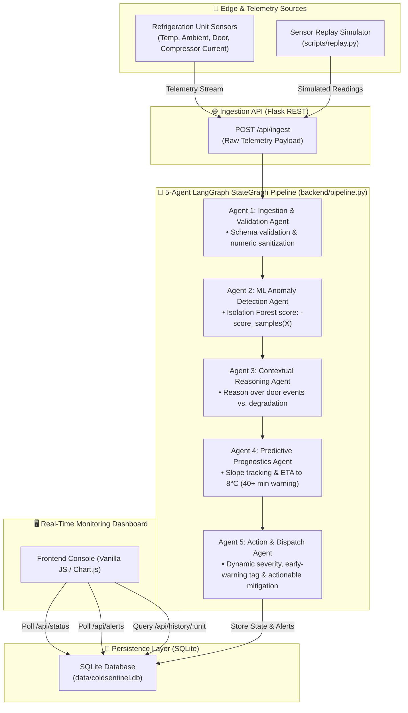
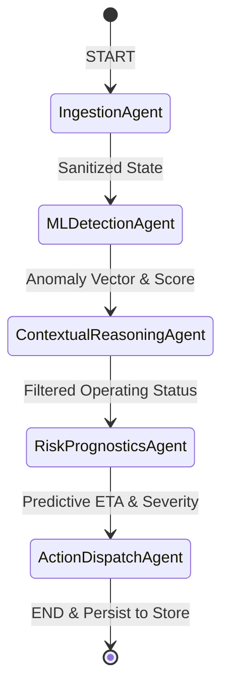

# ColdSentinel: 5-Agent LangGraph Anomaly & Failure Prediction Pipeline

[](https://www.python.org/downloads/)
[](https://github.com/langchain-ai/langgraph)
[](https://scikit-learn.org/)
[](LICENSE)

**ColdSentinel** is an intelligent, agentic IoT monitoring and early-warning prognostic system for refrigeration units and cold-chain infrastructure (vaccines, pharmaceuticals, biologics, and perishable logistics).

Architected as a **5-Agent LangGraph StateGraph pipeline**, ColdSentinel combines Machine Learning (Isolation Forest anomaly detection) with real-time contextual reasoning across multi-sensor telemetry to detect cooling degradation, suppress benign false alarms (e.g., door openings), and predict **Time-To-Failure (ETA to critical 8.0°C) 40+ minutes in advance**.

---

## 🏛️ System Architecture



---

## 🤖 The 5-Agent LangGraph Pipeline

ColdSentinel models risk reasoning as an explicit graph using **LangGraph's `StateGraph`**:



| Agent | Name | Responsibility & Reasoning |
|---|---|---|
| **Agent 1** | **Ingestion & Validation Agent** | Validates incoming IoT payload structure, casts telemetry to standardized float representations, and ensures data integrity. |
| **Agent 2** | **ML Anomaly Detection Agent** | Evaluates a 12-dimensional telemetry feature vector via pre-trained **Isolation Forest** (`model/iforest.joblib`), outputting an anomaly score and anomaly flag against decision thresholds. |
| **Agent 3** | **Contextual Reasoning Agent** | Performs contextual domain reasoning. Differentiates benign door-open spikes from compressor degradation; suppresses false alarms when door is open while compressor current remains nominal. |
| **Agent 4** | **Risk Prognostics Agent** | Tracks temperature slope trajectory using rolling median filtering to eliminate transient spikes. Computes prognostic **Time-To-Failure (ETA to $8.0^\circ\text{C}$)** with an early-warning window **40+ minutes ahead of failure**. |
| **Agent 5** | **Action & Dispatch Agent** | Classifies risk severity (`critical` $\le 20\text{m}$, `high` $\le 45\text{m}$, `medium`, `watch`), injects early warning tags, and synthesizes clear, actionable mitigation instructions for facility operators. |

---

## 🚀 Key Highlights & Capabilities

- **40+ Minute Early Warning Window**: Identifies cooling system degradation well in advance before product temperatures reach the critical spoilage threshold ($8.0^\circ\text{C}$), allowing staff ample time to relocate stock or service compressors.
- **Context-Aware False Alarm Suppression**: Uses domain heuristics to identify benign door access events, preventing alert fatigue.
- **Stateful LangGraph Architecture**: Built on LangGraph `StateGraph` passing a typed, extensible `PipelineState` between specialized agents.
- **Sub-Second Real-Time Inference**: Pipeline runs deterministically in milliseconds per reading, suitable for high-frequency IoT streaming.
- **Interactive Web Dashboard**: Live status cards, alert feed, and historical temperature trend charts.

---

## 📂 Project Structure

```
ColdSentinel/
├── app.py                  # Flask web server and REST API endpoints
├── backend/
│   ├── pipeline.py         # 5-Agent LangGraph StateGraph pipeline & state definitions
│   ├── predictor.py        # ML Isolation Forest inference loader
│   └── store.py            # SQLite database schema, insert, and query functions
├── data/
│   ├── coldsentinel.csv    # Multi-unit time-series sensor benchmark dataset
│   └── coldsentinel.db     # Local SQLite database (auto-generated)
├── model/
│   └── iforest.joblib      # Pre-trained Isolation Forest model & metadata
├── scripts/
│   └── replay.py           # Ingestion simulator streaming sensor readings
├── static/
│   ├── css/style.css       # Clean dashboard styling
│   └── js/app.js           # Live data polling and chart rendering
├── templates/
│   └── index.html          # Web monitoring console
├── test_pipeline.py        # Pipeline & agent validation tests
├── test_predictor.py       # ML scoring unit tests
├── test_store.py           # SQLite persistence tests
├── requirements.txt        # Python dependencies (including LangGraph)
├── .gitignore              # Git exclusions
└── README.md               # Documentation and architecture guide
```

---

## ⚙️ Quickstart Guide

### 1. Clone the Repository
```bash
git clone https://github.com/Khushee2023/ColdSentinel.git
cd ColdSentinel
```

### 2. Set Up Virtual Environment
```bash
# Windows
python -m venv venv
venv\Scripts\activate

# macOS / Linux
python3 -m venv venv
source venv/bin/activate
```

### 3. Install Dependencies
```bash
pip install -r requirements.txt
```

### 4. Launch the Web Application
```bash
python app.py
```
Open your browser and navigate to **`http://127.0.0.1:5000`**.

### 5. Stream Sensor Telemetry (Replay Simulator)
In a separate terminal (with virtual environment activated):
```bash
python scripts/replay.py --delay 0.5
```

---

## 📡 REST API Reference

| Method | Endpoint | Description |
|---|---|---|
| `GET` | `/` | Web monitoring console |
| `POST` | `/api/ingest` | Streams a sensor reading through the 5-Agent LangGraph pipeline |
| `GET` | `/api/status` | Returns latest status reading for each refrigeration unit |
| `GET` | `/api/alerts` | Returns recent alerts ordered by timestamp |
| `GET` | `/api/history/<unit_id>` | Historical readings for a specific unit (for charts) |
| `POST` | `/api/reset` | Resets pipeline agent memory and clears SQLite database |

### Telemetry Ingestion Payload Example (`POST /api/ingest`)
```json
{
  "unit_id": "unit_01",
  "timestamp": "2026-11-02 14:00:00",
  "temp_c": 5.4,
  "ambient_c": 22.1,
  "door_open": 0,
  "compressor_on": 1,
  "current_a": 4.2,
  "temp_mean_15m": 5.1,
  "temp_std_15m": 0.2,
  "temp_slope_15m": 0.08,
  "current_mean_15m": 4.1,
  "duty_cycle_15m": 0.85,
  "door_opens_15m": 0,
  "temp_dev_setpoint": 1.4
}
```

---

## 🧪 Testing

Run test scripts to verify the LangGraph agent graph, ML scoring, and database store:
```bash
python test_pipeline.py
python test_predictor.py
python test_store.py
```

---

## 📄 License

This project is licensed under the MIT License.
