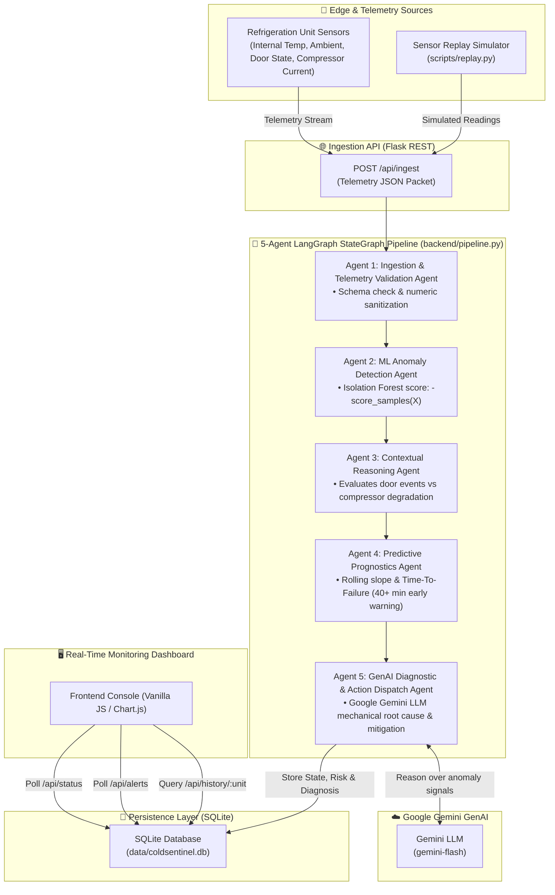
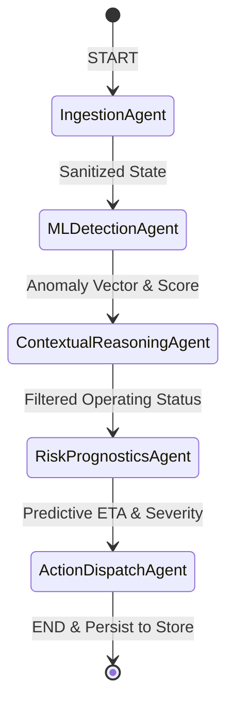

# ColdSentinel: 5-Agent LangGraph & Gemini GenAI Failure Prediction Pipeline

[](https://www.python.org/downloads/)
[](https://github.com/langchain-ai/langgraph)
[](https://ai.google.dev/)
[](https://scikit-learn.org/)
[](LICENSE)

**ColdSentinel** is an intelligent, Agentic AI monitoring, diagnostic, and predictive early-warning prognostic system for refrigeration units and cold-chain infrastructure (vaccines, pharmaceuticals, biologics, and perishable logistics).

Architected as a **5-Agent LangGraph StateGraph pipeline powered by Machine Learning (Isolation Forest) and Generative AI (Google Gemini LLM)**, ColdSentinel reasons over multi-sensor telemetry in real time to detect cooling degradation, eliminate benign false alarms (such as door-open events), diagnose mechanical root causes, and predict **Time-To-Failure (ETA to critical 8.0°C) 40+ minutes in advance**.

---

## 🏛️ System Architecture



---

## 🤖 The 5-Agent LangGraph Multi-Agent Architecture

ColdSentinel models telemetry ingestion and risk reasoning as an explicit graph using **LangGraph's `StateGraph`**:



| Agent | Name | Implementation | Reasoning & Responsibility |
|---|---|---|---|
| **Agent 1** | **Ingestion & Validation Agent** | `ingestion_agent` | Validates incoming IoT payload structure, casts telemetry to standardized float representations, and ensures data integrity. |
| **Agent 2** | **ML Anomaly Detection Agent** | `ml_detection_agent` | Evaluates a 12-dimensional telemetry feature vector via pre-trained **Isolation Forest** (`model/iforest.joblib`), outputting continuous anomaly scores. |
| **Agent 3** | **Contextual Reasoning Agent** | `contextual_reasoning_agent` | Performs contextual domain reasoning. Differentiates benign door-open spikes from compressor degradation; suppresses false alarms when door is open while compressor current remains nominal. |
| **Agent 4** | **Risk Prognostics Agent** | `risk_prognostics_agent` | Tracks temperature slope trajectory using rolling median filtering to eliminate transient spikes. Computes prognostic **Time-To-Failure (ETA to $8.0^\circ\text{C}$)** with an early-warning window **40+ minutes ahead of failure**. |
| **Agent 5** | **GenAI Diagnostic & Action Dispatch Agent** | `action_dispatch_agent` | Synthesizes **Google Gemini LLM** prompts to diagnose mechanical root cause (e.g. compressor overload, refrigerant leak, coil icing) and outputs clear, prescriptive operational actions for facility technicians. |

---

## 🚀 Key Highlights & Capabilities

- **Truly Agentic AI Architecture**: Multi-agent orchestration using **LangGraph `StateGraph`** paired with **Google Gemini LLM** for deep root-cause synthesis.
- **40+ Minute Early Warning Prognostics**: Predicts exact failure time before internal temperature reaches the critical $8.0^\circ\text{C}$ spoilage limit, giving technicians ample time to relocate stock.
- **Context-Aware False Alarm Suppression**: Eliminates alert fatigue by understanding environmental context (door access events vs compressor degradation).
- **Sub-Second Streaming Inference**: Low-latency edge processing with in-memory caching and resilient expert fallback.
- **Interactive Web Dashboard**: Real-time status cards, live alerts, and historical telemetry trend graphs.

---

## 📂 Project Structure

```
ColdSentinel/
├── app.py                  # Flask web server and REST API endpoints
├── backend/
│   ├── pipeline.py         # 5-Agent LangGraph StateGraph pipeline & state definitions
│   ├── predictor.py        # ML Isolation Forest inference loader
│   ├── llm_agent.py        # Google Gemini GenAI root-cause diagnostic agent
│   └── store.py            # SQLite database schema, insert, and query functions
├── data/
│   ├── coldsentinel.csv    # Multi-unit time-series sensor benchmark dataset
│   └── coldsentinel.db     # Local SQLite database (auto-generated)
├── model/
│   └── iforest.joblib      # Pre-trained Isolation Forest model & metadata
├── scripts/
│   └── replay.py           # Ingestion simulator streaming sensor readings
├── static/
│   ├── css/style.css       # Clean dashboard styling
│   └── js/app.js           # Live data polling and chart rendering
├── templates/
│   └── index.html          # Web monitoring console
├── test_pipeline.py        # Pipeline & agent validation tests
├── test_predictor.py       # ML scoring unit tests
├── test_store.py           # SQLite persistence tests
├── requirements.txt        # Python dependencies (LangGraph, Gemini, Flask, scikit-learn)
├── .env.example            # Environment variables template
├── .gitignore              # Git exclusions (protects local .env & db)
└── README.md               # Documentation and architecture guide
```

---

## ⚙️ Quickstart Guide

### 1. Clone the Repository
```bash
git clone https://github.com/Khushee2023/ColdSentinel.git
cd ColdSentinel
```

### 2. Set Up Virtual Environment
```bash
# Windows
python -m venv venv
venv\Scripts\activate

# macOS / Linux
python3 -m venv venv
source venv/bin/activate
```

### 3. Install Dependencies
```bash
pip install -r requirements.txt
```

### 4. Configure Environment Variables
Copy `.env.example` to `.env` and set your Google Gemini API key:
```bash
cp .env.example .env
```
Inside `.env`:
```env
GEMINI_API_KEY=your_gemini_api_key_here
```

### 5. Launch the Web Application
```bash
python app.py
```
Open your browser and navigate to **`http://127.0.0.1:5000`**.

### 6. Stream Sensor Telemetry (Replay Simulator)
In a separate terminal (with virtual environment activated):
```bash
python scripts/replay.py --delay 0.5
```

---

## 📡 REST API Reference

| Method | Endpoint | Description |
|---|---|---|
| `GET` | `/` | Web monitoring console |
| `POST` | `/api/ingest` | Streams a sensor reading through the 5-Agent LangGraph pipeline |
| `GET` | `/api/status` | Returns latest status reading for each refrigeration unit |
| `GET` | `/api/alerts` | Returns recent alerts ordered by timestamp |
| `GET` | `/api/history/<unit_id>` | Historical readings for a specific unit (for charts) |
| `POST` | `/api/reset` | Resets pipeline agent memory and clears SQLite database |

---

## 🧪 Testing

Run test scripts to verify the LangGraph agent graph, ML scoring, and database store:
```bash
python test_pipeline.py
python test_predictor.py
python test_store.py
```

---

## 📄 License

This project is licensed under the MIT License.
