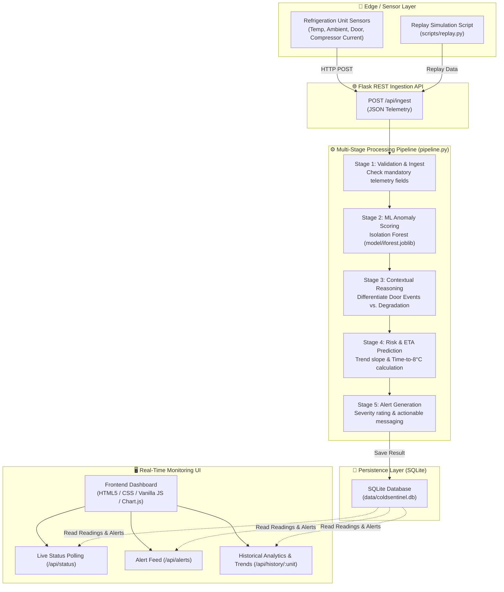

# ColdSentinel: IoT & AI-Powered Cold Chain Failure Prediction & Anomaly Detection

[](https://www.python.org/downloads/)
[](https://flask.palletsprojects.com/)
[](https://scikit-learn.org/)
[](LICENSE)

**ColdSentinel** is an intelligent monitoring, early-warning, and predictive anomaly detection system built specifically for cold chains (pharmaceuticals, vaccines, food refrigeration units, and cold storage logistics).

Rather than reacting to basic threshold violations after food or medical products are compromised, ColdSentinel continuously scores multi-sensor telemetry with Machine Learning (Isolation Forest) and contextual reasoning to detect cooling degradation, predict **Time-To-Failure (ETA to critical threshold)**, and suppress false alarms caused by normal door openings.

---

## Architecture Diagram



---

## Key Features

1. **Machine Learning Anomaly Detection (Isolation Forest)**:
   - Evaluates a 12-dimensional telemetry feature vector including ambient temperature, compressor current, short-term moving averages, and rolling slope dynamics.
2. **Context-Aware False Alarm Suppression**:
   - Differentiates benign door-open actions from compressor degradation. If door opens while compressor current remains within standard operating levels, flags as harmless watch rather than alerting.
3. **Predictive ETA to Failure Calculation**:
   - Dynamically tracks rolling temperature slope ($\Delta T / \Delta t$) using a rolling median buffer to compute accurate remaining minutes until unit hits the critical failure boundary ($8.0^\circ\text{C}$).
4. **Dynamic Severity Categorization**:
   - Automatically prioritizes issues into `critical` ($\le 20\text{ min}$ to failure), `high` ($\le 45\text{ min}$), `medium`, or `watch`.
5. **Real-Time Interactive Dashboard**:
   - Modern, responsive dashboard showing per-unit live cards, alert feeds, and historical telemetry trends.
6. **Sensor Replay Simulator**:
   - Built-in simulation tool to replay historical or stress-testing datasets through the ingestion pipeline in synchronized intervals.

---

## 5-Stage Detection & Reasoning Pipeline

```
[ Raw Telemetry ]
       │
       ▼
1. INGEST & VALIDATE ─────> Validates unit_id, timestamp, temp_c, and required telemetry.
       │
       ▼
2. ML DETECT (Isolation) ─> Computes anomaly score: -score_samples(X) > THRESHOLD.
       │
       ▼
3. CONTEXT REASONING ────> Checks consecutive anomalous flags & door opening states.
       │                   • Single flag -> "watch"
       │                   • Door open + normal compressor current -> "watch" (suppressed)
       │                   • Consecutive sustained anomalies -> "alert"
       ▼
4. RISK & ETA ASSESSMENT ─> Tracks rolling median temp slope:
       │                   • ETA (min) = (8.0°C - temp_c) / slope
       │                   • Assigns severity: Critical (≤20m), High (≤45m), Medium.
       ▼
5. ACTIONABLE ALERTS ────> Generates prescriptive messages and persists to SQLite store.
```

---

## Project Structure

```
ColdSentinel/
├── app.py                  # Flask web server and API endpoints
├── backend/
│   ├── pipeline.py         # 5-stage inference, reasoning, and risk pipeline
│   ├── predictor.py        # ML Isolation Forest inference loader
│   └── store.py            # SQLite database schema, insert, and query functions
├── data/
│   ├── coldsentinel.csv    # Sample time-series sensor data for replay
│   └── coldsentinel.db     # Local SQLite database (auto-generated)
├── model/
│   └── iforest.joblib      # Pre-trained Isolation Forest model & metadata
├── scripts/
│   └── replay.py           # Ingestion simulator replaying sensor readings
├── static/
│   ├── css/style.css       # Clean dashboard styling
│   └── js/app.js           # Live data polling and chart rendering
├── templates/
│   └── index.html          # Web monitoring console
├── test_pipeline.py        # Unit tests for the 5-stage pipeline
├── test_predictor.py       # Unit tests for model scoring
├── test_store.py           # Unit tests for database store
├── requirements.txt        # Python dependencies
├── .gitignore              # Ignored files and directories
└── README.md               # Documentation and architecture guide
```

---

## Getting Started

### 1. Prerequisites
- Python 3.10 or higher
- Git

### 2. Clone Repository
```bash
git clone https://github.com/Khushee2023/ColdSentinel.git
cd ColdSentinel
```

### 3. Set Up Virtual Environment
```bash
# Windows
python -m venv venv
venv\Scripts\activate

# macOS / Linux
python3 -m venv venv
source venv/bin/activate
```

### 4. Install Dependencies
```bash
pip install -r requirements.txt
```

### 5. Run the Application
Start the Flask web server:
```bash
python app.py
```
Open your browser and navigate to `http://127.0.0.1:5000`.

### 6. Run the Sensor Replay Simulation
In a separate terminal (with the virtual environment activated), stream sample sensor data into the live server:
```bash
python scripts/replay.py --delay 0.5
```

---

## REST API Reference

| Method | Endpoint | Description |
|---|---|---|
| `GET` | `/` | Renders the real-time monitoring web dashboard |
| `POST` | `/api/ingest` | Ingests a single sensor reading and processes it through the pipeline |
| `GET` | `/api/status` | Returns the latest status reading for each refrigeration unit |
| `GET` | `/api/alerts` | Fetches the recent alerts list ordered by timestamp |
| `GET` | `/api/history/<unit_id>` | Returns time-series historical data for a specific unit (for charts) |
| `POST` | `/api/reset` | Clears historical data and resets in-memory pipeline state |

### Sample Telemetry Ingestion Payload (`POST /api/ingest`)
```json
{
  "unit_id": "unit_01",
  "timestamp": "2026-11-02 14:00:00",
  "temp_c": 5.4,
  "ambient_c": 22.1,
  "door_open": 0,
  "compressor_on": 1,
  "current_a": 4.2,
  "temp_mean_15m": 5.1,
  "temp_std_15m": 0.2,
  "temp_slope_15m": 0.08,
  "current_mean_15m": 4.1,
  "duty_cycle_15m": 0.85,
  "door_opens_15m": 0,
  "temp_dev_setpoint": 1.4
}
```

---

## Testing

Run the test suite to verify pipeline integrity:
```bash
python test_pipeline.py
python test_predictor.py
python test_store.py
```

---

## License

This project is licensed under the MIT License.
